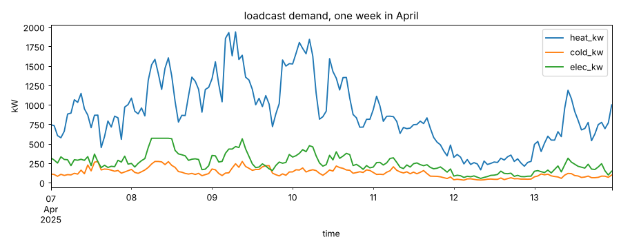
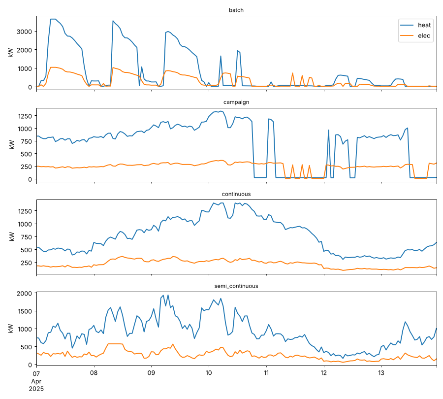
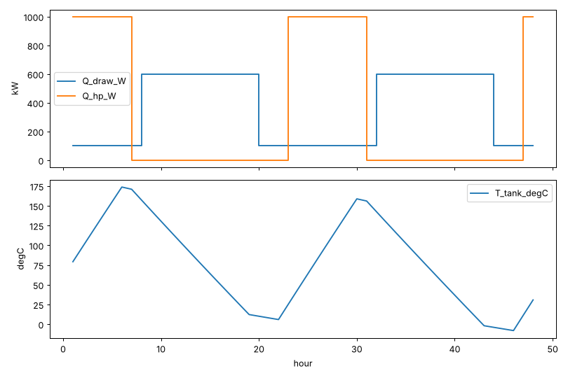
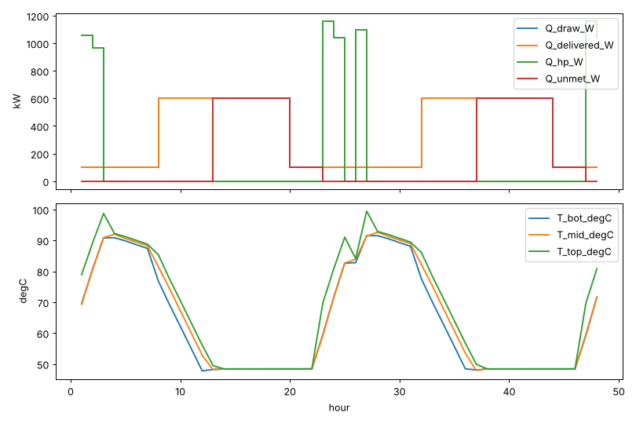

# Experiment log

Running notes on what I tried, what worked, and what didn't. Newest phase at
the top. Plots are in `notes/images/`.

---

## Phase 0: setup, data, and "can Modelica even do this?"

Goal of phase 0: get the environment working, pull every data source once,
and find out early whether the Modelica → FMU → Python idea works at all,
since that's the riskiest part of the plan.

### Summary

| Thing | Status | Notes |
|---|---|---|
| Python environment | ✅ works | Python 3.13, but there's a pandas version fight (see 0.1) |
| loadcast demand | ✅ works | ran it, plus 3 experiments on its settings (0.2) |
| NSRDB weather | ⚠️ written, not run yet | script is ready, needs an NREL API key (0.3) |
| CAISO prices | ⚠️ written, not run yet | no key needed, just hasn't been run (0.4) |
| CAISO CO2 | ⚠️ written, not run yet | same (0.5) |
| Modelica FMU (simple tank) | ✅ works | |
| Modelica FMU (Buildings Library heat pump + tank) | ✅ works, after 4 failed attempts | a full year steps in ~5 s (0.6) |

---

### 0.1 Environment: the pandas fight

**Tried:** `pip install` everything for all phases at once (pvlib, gridstatus,
loadcast, fmpy, pypsa, tespy, statsforecast, mlforecast, lightgbm).

**Didn't work:** pip pulled in pandas 3.1 because the newest PyPSA (1.4)
requires pandas ≥ 3. But gridstatus 0.37 requires pandas 2.x
(`pandas~=2.2`). pip installs it anyway and only prints a warning, so it
would have broken later in a confusing way.

**What worked:** pin `pandas<3` and `pypsa<1.3` (PyPSA 1.2 is the last one
that accepts pandas 2). A fresh venv from `requirements.txt` installs clean,
`pip check` is happy, and a tiny PyPSA battery test solves with HiGHS.

**Lesson:** install the later-phase libraries now, even though we don't use
them yet. Better to find the clash on day 1.

---

### 0.2 Demand from loadcast

Script: `phase0/02_demand_loadcast.py`

Base case: 10 GWh/yr, 20% electricity, heat:cold 7.4, semi-continuous,
correlation 0.75, year 2025.

| | annual MWh | mean kW | peak kW |
|---|---|---|---|
| heat | 7,048 | 805 | 2,006 |
| cold | 952 | 109 | 271 |
| elec | 2,000 | 228 | 569 |

**Experiment A: the four process classes** (same annual energy)

| class | heat peak kW | heat load factor | hours with heat < 10% of peak |
|---|---|---|---|
| batch | 3,640 | 0.22 | 5,301 |
| campaign | 1,599 | 0.50 | 1,717 |
| continuous | 1,397 | 0.58 | 0 |
| semi_continuous | 2,006 | 0.40 | 113 |

Batch is wild: the peak is almost 2× semi-continuous and the plant is idle
60% of the year. That would make storage look amazing. Sticking with
semi-continuous for v1 since it's the middle ground, but batch is an
interesting "later" case.

**Experiment B: does `carrier_correlation` do what it says?**

| asked for | measured heat vs elec | measured heat vs cold |
|---|---|---|
| 0.00 | 0.46 | 0.46 |
| 0.25 | 0.46 | 0.46 |
| 0.50 | 0.50 | 0.50 |
| 0.75 | 0.75 | 0.75 |
| 0.95 | 0.95 | 0.95 |

Above 0.5 it's spot on. **Below about 0.46 it can't go any lower** and
loadcast prints a `TargetMissedWarning`: all carriers share the same shift
calendar, so they move together even if the random part is independent.
The fix it suggests is to give a carrier its own calendar
(`DemandSpec.calendars`). Worth remembering for the correlation sweep later:
the sweep should start at 0.5, not 0.

**Experiment C: different random seed, same settings**

Seed 42 vs seed 7: annual heat is identical (7,048 MWh, loadcast rescales to
hit the target) but the hourly correlation between the two is only 0.47.
So "same plant, different year" gives a pretty different profile. That's
useful: the twin can train forecasters on one seed and "measure" on
another, instead of just adding noise.

**Something I noticed for phase 1:** average heat demand is 805 kW but the
proposal's heat pump is 1 MW. The heat pump would have to run ~80% of all
hours just to keep up on energy, and the peak (2 MW) is double its size.
Either the heat pump goes up to ~1.5–2 MW or we add a backup gas boiler
(which most food plants actually have). Need to decide in phase 1.

---

### 0.3 Weather from NSRDB

Script: `phase0/03_weather_nsrdb.py`

**Not run yet**, it needs a free NREL API key (put it in `.env`, see
`.env.example`). I also couldn't reach NREL's servers from the machine I
was on.

Things I found while writing it:
- NREL got renamed (National Laboratory of the Rockies) and the API moved
  from `developer.nrel.gov` to `developer.nlr.gov`. pvlib 0.16 already uses
  the new address. Older pvlib versions probably won't work.
- Asks for the real year 2025 first (so weather lines up with 2025 prices),
  and falls back to the typical meteorological year (TMY) if 2025 isn't
  published yet. TMY is a mash-up of different years, so it should NOT be
  lined up with real prices. The script names the file differently so I
  don't mix them up by accident.
- **Timestamps.** NSRDB returns local standard time (UTC-8 all year, no
  daylight saving). CAISO data is in Pacific time with DST. If these aren't
  lined up, PV ends up an hour off for half the year. I decided to keep
  everything in UTC-8 (`config.TIMEZONE`). The script also prints the first
  timestamps because NSRDB hourly data has been stamped at hh:30 in the
  past. Check that when it runs.
- Includes a rough PV check (1 MWp, fixed tilt, PVWatts). I tested that
  part on clear-sky data (no clouds at all) and got 2,031 kWh/kWp with the
  peak at 12:00, so the real number should land a bit under that, around
  1,700–2,000.

---

### 0.4 CAISO day-ahead prices

Script: `phase0/04_prices_caiso.py`. **Not run yet.**

- Price node: `DLAP_PGAE-APND`, the price PG&E-area load pays. Fresno is in
  PG&E territory. The trading hub `TH_ZP26_GEN-APND` is a backup if DLAP
  doesn't work.
- gridstatus says `get_lmp()` is deprecated and to use
  `get_lmp_day_ahead_hourly()` instead, but that one downloads **every node
  in CAISO** with no way to pick one. So I kept `get_lmp()` with a single
  node and silenced the warning. Might break in a future gridstatus.
- Downloads month by month and saves each month, so a timeout doesn't lose
  everything. Re-running skips finished months.
- Also keeps the GHG part of the price (CAISO puts a carbon cost into the
  LMP), might be useful later.

### 0.5 CAISO grid CO2

Script: `phase0/05_co2_caiso.py`. **Not run yet.**

There's no free official hourly CO2 number, so: 5-minute fuel mix →
hourly average MW → multiply by a rough emission factor per fuel → divide
by total generation. Factors: gas 430, imports 428 (CARB's default for
unspecified imports), coal 1000, everything else 0. Batteries left out
because they just shift other generation in time.

Known weak spots: imports are a big chunk of CAISO at night and the 428 is a
guess. Biomass counted as zero is debatable.

---

### 0.6 Modelica → FMU → Python

This was the big unknown. Setup: OpenModelica in Docker (no install
needed), Modelica Standard Library 4.1.0 and Buildings Library 14.0.0 cloned
from GitHub, FMPy on the Python side. Build with `bash modelica/build_fmus.sh`.

**Attempt 1 — tiny tank, Standard Library only** (`SimpleTank.mo`):
✅ worked first time. One heat capacity, heat in, heat out, a loss. Exported
as a co-simulation FMU, stepped hourly from Python with FMPy.

But look at the temperatures: it happily goes to **174 °C** and down to
**−8 °C**. Nothing stops the heat pump on a full tank or the process on an
empty one. Fine as a pipeline test, useless as a "real plant". That's the
point of using the Buildings Library.

**Attempt 2 — Buildings Library with OpenModelica 1.25.5:**
❌ couldn't even load the library:
`Error: Missing token: ')'` in two Buildings example files. They use
`extends ChillerWSE(break uti, ...)`, which is newer Modelica syntax that
OMC 1.25 doesn't understand.
**Fix:** OpenModelica 1.26.3 loads it fine.

**Attempt 3 — heat pump with air on the evaporator side:**
❌ "Initialization problem is structurally singular". With
`-d=initialization` it said the evaporator's air pressure was being fixed
twice (once by the component's own start value, once by the air outlet
boundary). Switching the heat pump to steady state got it to build, but
then it crashed on the first step: the heat pump reported **−39.6 MW**
(negative!) of heating, i.e. the solver found a nonsense solution where the
condenser was colder than the evaporator.

**Attempt 4 — same thing, but with the CVODE solver:**
❌ same −39.6 MW crash. I tried this because OpenModelica's co-simulation
FMUs use plain forward Euler by default with a fixed step, and the step was
taken from my `experiment(Interval=3600)` annotation, so it was doing one
Euler step per hour. That's bad (see below), but it wasn't the problem here.
Kept the flag anyway: `setCommandLineOptions("--fmiFlags=s:cvode")`.

**Attempt 5 — swap the air for a water loop at outdoor temperature:**
With water on the evaporator side the "pressure fixed twice" problem goes
away, so I could put the heat pump's own dynamics back on (`FixedInitial`)
instead of steady state. That got rid of the negative-heat solution.
❌ ran 19 hours, then crashed with "water temperature = −4 °C". The tank had
run empty during the day shift and the process model kept pulling heat out
of cold water. So it was doing exactly what I asked.
**Fix:** the process only gets heat while the top of the tank is above
50 °C (fading out over 5 K). The rest is reported as `Q_unmet_W`. That's
actually a useful output: "unmet heat" is a good way to score a bad plan.

The evaporator being a water/brine loop at outdoor temperature (clamped at
2 °C so the water doesn't freeze) instead of air is a simplification, but a
fair one for a demo.

**Attempt 6:** ✅ works.

**Was CVODE needed after all?** I rebuilt the working model without the
`--fmiFlags=s:cvode` flag: it fails at t = 3600 s (the first Euler step).
So yes, keep it. Both fixes were needed.

What it shows with a dumb "heat pump on 22:00–06:00" schedule:
- The safety cut-out works: compressor stops at 90 °C at the top and
  restarts at 85 °C.
- COP comes out around 2.3–2.5 (Q ≈ 1.05–1.16 MW for 465 kW electric).
  Reasonable for 85 °C water from 12–20 °C ambient.
- The tank (70 m³, about 3 MWh usable between 50 and 90 °C) runs out
  around 13:00, and then **600 kW goes unmet for 7 hours**. That's the
  plan-versus-plant gap the proposal talks about, already visible with a
  silly schedule.
- The tank barely stratifies: top and bottom are within a few degrees most
  of the time. Probably because the load loop pulls from the top and
  dumps into the bottom at 15 kg/s constantly. Something to look at later.
- **Speed:** a full year (8,760 hourly steps) runs in about 5 s. Fast
  enough for the twin loop.

Gotchas for later:
- The outputs are the value **at the end of each hour**, not the hourly
  average. That's why `Q_hp_W` reads 0 in hours where the heat pump ran for
  part of the hour and then cut out. For energy accounting I'll need to add
  integrators to the model (energy in J, read the difference each hour).
- The FMU is built for Linux 64-bit. On Mac/Windows rebuild it with
  `build_fmus.sh` (Docker builds a Linux binary though, so for a native
  Mac/Windows FMU you'd need OpenModelica installed natively).

---

## Things to decide in phase 1
- Heat pump size: 1 MW is too small for 805 kW average heat demand. Bigger
  heat pump, or add a backup boiler?
- Which weather year: real 2025 if NSRDB has it, otherwise 2024 for
  everything (prices too) so they line up.
- Add energy integrators to the FMU outputs.
